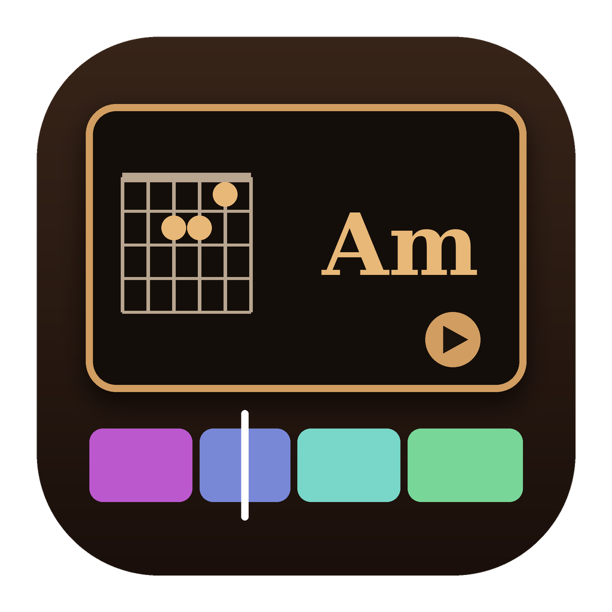

# Backtrack Acordes

Sube una canción en **MP3 o WAV** y la app detecta sus **acordes para guitarra**, te deja elegir la
**cejilla**, reproduce la canción con los acordes avanzando en la **línea de tiempo** (modo backtrack)
y exporta un **vídeo backtrack** y un **PDF** con la notación de los acordes. Todo en tu ordenador.

Usa exactamente el mismo motor de acordes, cejilla y exportación que la app *Guitarra Flamenca*,
sin la parte de convertir a guitarra con el plugin.

## Qué hace
- **Detección de acordes** (`acordes.py`): pulso del original, notas con la red de Spotify
  *basic-pitch* + espectro CQT afinado y blanqueado con NNLS, croma de bajos y de agudos,
  plantillas (mayor, menor, 7, maj7, m7, dim, sus4), modelo de Márkov (Viterbi), tonalidad
  (mayor, menor y modo flamenco) con corrección modal, compás y primeros tiempos.
  Antes se separa la percusión para que no ensucie la armonía (`analisis.py`).
- **Línea de tiempo** sincronizada: acorde actual con su diagrama, siguiente con cuenta atrás,
  compases, zoom, velocidad de reproducción y fiabilidad de cada acorde. Pulsa un acorde para
  corregirlo (alternativas que ha oído la app o elige tú).
- **Cejilla**: automática (la que hace caer la canción en las formas más idiomáticas) o en el traste
  que quieras (0-9). Posturas flamencas o naturales, con conducción de voces (`guitarra_ritmica.py`).
- **Vídeo backtrack** horizontal 16:9 (MP4 H.264 + AAC) con el audio original (`exportar.py`):

  | Formato | Resolución | Codificación |
  |---|---|---|
  | Full HD | 1920×1080 | CRF 18 |
  | HD | 1280×720 | CRF 21 |
  | WhatsApp | 960×540 | H.264 *main*, AAC 96k, peso calculado para quedar por debajo de 16 MB |

- **PDF** A4 horizontal: tonalidad, tempo, compás y cejilla; diagramas de todos los acordes;
  partitura de acordes compás a compás.
- Lista de acordes en `.txt` (con formato `.lab` de MIREX).

## Instalación (macOS, una vez)
Clic derecho en **`instalar.command`** → Abrir. Necesita Python 3.10 (lo instala con Homebrew si falta).

## Uso
- Abrir: icono **Backtrack Acordes.app** (o `Iniciar Backtrack Acordes.command`).
- Cerrar: `Parar Backtrack Acordes.command`.

Se abre en `http://127.0.0.1:8921` (o el siguiente puerto libre hasta el 8929; no choca con otras apps).

## Archivos
| Archivo | Qué es |
|---|---|
| `server.py` | servidor local (Flask) |
| `analisis.py` | lectura de MP3/WAV, separación de percusión, afinación y notas (basic-pitch) |
| `acordes.py` | detección de acordes, tonalidad, tempo y compás |
| `guitarra_ritmica.py` | posturas, cejilla y conducción de voces |
| `exportar.py` | vídeo backtrack y PDF |
| `index.html` | la interfaz |
| `make_icon.py` | dibuja el icono |

## Créditos
- Detección de notas: *basic-pitch* © Spotify (Apache 2.0).
- Tipografía DejaVu (licencia libre, en `fuentes/`).
